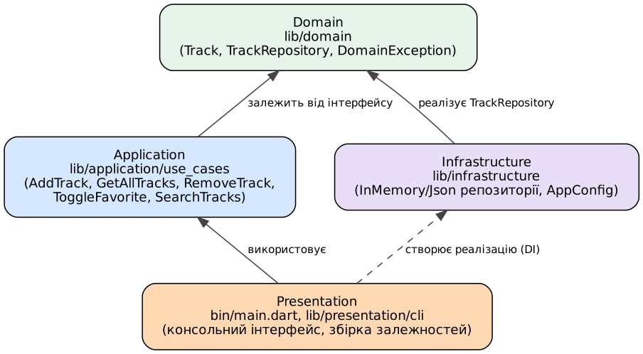

# Music Library

Консольний застосунок "Музична бібліотека" на Dart. Побудований за принципами Clean Architecture.
Лабораторна робота 5: Побудова архітектури застосунку. Робота з Git.

## Можливості

- перегляд списку треків;
- додавання треку (з перевіркою правил);
- видалення треку;
- позначка "улюблений";
- пошук за назвою або виконавцем.

## Архітектура



Залежності спрямовані до центру: Presentation і Infrastructure залежать від внутрішніх шарів, а Domain не залежить ні від чого.

| Шар | Каталог | Що містить |
|---|---|---|
| Domain | `lib/domain` | сутність `Track`, інтерфейс `TrackRepository`, `DomainException` |
| Application | `lib/application/use_cases` | use cases, які працюють тільки через `TrackRepository` |
| Infrastructure | `lib/infrastructure` | `InMemoryTrackRepository`, `JsonTrackRepository`, `AppConfig` |
| Presentation | `bin/main.dart`, `lib/presentation/cli` | консольне меню та збірка залежностей (DI) |

```
lib/
  domain/
    entities/track.dart
    errors/domain_exception.dart
    repositories/track_repository.dart
  application/use_cases/
    add_track.dart  get_all_tracks.dart  remove_track.dart
    toggle_favorite.dart  search_tracks.dart
  infrastructure/
    config/app_config.dart
    repositories/in_memory_track_repository.dart
    repositories/json_track_repository.dart
  presentation/cli/cli.dart
bin/main.dart
config/app_config.json
```

## Збірка і запуск

Потрібен Dart SDK 3.0 або новіший.

```
dart pub get
dart analyze
dart run bin/main.dart          # інтерактивне меню
dart run bin/main.dart demo     # автоматичний сценарій
```

Спосіб зберігання даних задається у `config/app_config.json` (`"storage": "memory"` або `"json"`).
Файл з даними за замовчуванням: `data/tracks.json`.

## Гілки і Git

- `main`: стабільний код, на ньому теги релізів (`v1.0.0`);
- `develop`: інтеграційна гілка;
- `feature/*`: гілки під окремі задачі, зливаються в `develop` через pull request.

Повідомлення комітів оформлені за Conventional Commits (`feat`, `fix`, `refactor`, `docs`, `chore`).

## Автор

Островський Артем, група 4КІ3.
